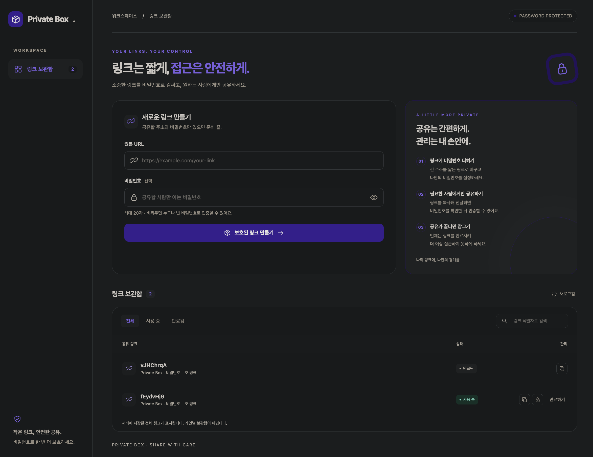
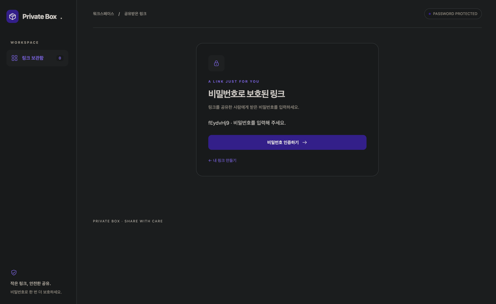
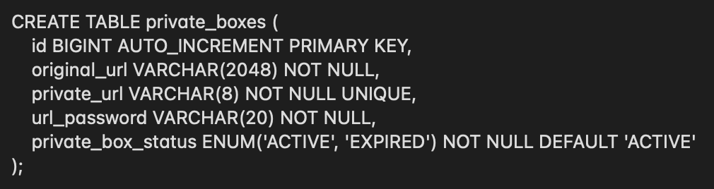

# Private Box 프로젝트


## 문제 정의

### 1. Target 사용자
URL을 공유할 때, 비밀번호를 알고 있는 특정 사용자에게만 접근을 허용하고 싶은 링크 공유자
공유한 URL에 대한 접근 권한을 직접 관리하고 싶은 사용자

### 2. 기존 서비스의 문제점
일반적인 단축 URL은 링크 주소만 알고 있으면 누구나 원본 URL에 접근할 수 있음
링크가 의도하지 않은 사용자에게 전달되더라도 접근을 제한하기 어려움
이미 공유한 링크의 접근을 차단하고 싶을 때, 링크 자체를 만료시키는 기능이 필요함

### 3. 해결 방안
비밀번호 기반 URL 접근 제어: 단축 URL에 비밀번호를 설정하여 올바른 비밀번호를 입력한 사용자만 원본 URL에 접근할 수 있도록 함
비밀번호 기반 URL 만료: 링크 생성자가 비밀번호 인증을 통해 기존 단축 URL을 직접 만료시킬 수 있도록 함

## AI 프론트 화면

### 기본 홈


### 비밀번호 입력



## ERD
domain과 table이 1개뿐이라서 schema 1개만 올림



## 기술적으로 고민한 부분

1. 책에서는 원본 URL로 리다이렉트할 때 HttpStatus.PERMANENT_REDIRECT(308)를 사용했습니다.
하지만 제가 구현한 단축 URL 프로젝트는 비밀번호 검증에 POST 요청을 사용하기 때문에,
308을 반환하면 원본 URL에도 POST 요청이 전달되는 문제가 있었습니다.
이를 해결하기 위해 리다이렉트 시 HTTP 메서드를 GET으로 변경하는 HttpStatus.SEE_OTHER(303)를 사용했습니다.

2. 하지만 303 SEE_OTHER로 변경한 이후에도 브라우저 화면이 원본 URL로 이동하지 않는 문제가 있었습니다.
원인을 확인해 보니, 프론트엔드에서 JavaScript의 fetch()를 사용하여 비밀번호 검증 API를 호출하고 있었기 때문이었습니다.
fetch()는 서버에서 반환한 리다이렉트 응답을 내부적으로 처리할 수 있지만, 브라우저의 현재 페이지를 자동으로 이동시키지는 않습니다.
따라서 백엔드에서 비밀번호 검증에 성공하면 원본 URL을 JSON 응답으로 반환하도록 수정하고, 프론트엔드에서 해당 URL을 받아 window.location.href로 페이지를 이동시키도록 구현했습니다.
이를 통해 API 요청의 리다이렉트와 실제 브라우저 페이지 이동은 서로 다르다는 점을 알게 되었습니다.

## API 명세

### 공통 사항

- 로컬 기본 주소: `http://localhost:8080`
- 요청 본문이 있는 API는 `Content-Type: application/json`을 사용한다.
- JSON 응답은 `Content-Type: application/json`이며, 응답 본문이 없는 성공 응답도 있다.
- `privateUrl`은 전체 URL이 아닌, 서버가 생성한 8자리 영문 대소문자·숫자 식별자다. 예: `Ab3dE7gH`
- 공유 주소는 `{기본 주소}/{privateUrl}` 형식이다. 예: `http://localhost:8080/Ab3dE7gH`
- 링크 상태는 `ACTIVE`(사용 가능), `EXPIRED`(만료) 두 가지다.
- 현재 별도의 사용자 인증은 없으며, 원본 URL 접근과 링크 만료 시 해당 링크의 비밀번호를 확인한다.

| 기능 | Method | 경로 | 성공 응답 |
| --- | --- | --- | --- |
| 메인 화면 | `GET` | `/` | `200 OK`, HTML |
| 공유 링크의 비밀번호 입력 화면 | `GET` | `/{privateUrl}` | `200 OK`, HTML |
| 링크 생성 | `POST` | `/private-box` | `201 Created` |
| 전체 링크 목록 조회 | `GET` | `/private-box` | `200 OK` |
| 비밀번호 인증 및 원본 URL 조회 | `POST` | `/private-box/{privateUrl}/verify` | `200 OK`, JSON |
| 링크 만료 | `PATCH` | `/private-box/{privateUrl}/expire` | `200 OK` |

### 공유 링크 접근 흐름

사용자가 `http://localhost:8080/mG7QcVbQ`를 열면 다음 순서로 동작한다.

1. 브라우저가 `GET /mG7QcVbQ`를 요청한다.
2. `PrivateBoxController`가 링크의 존재 여부와 상태를 확인한다. 존재하지 않으면 `404 Not Found`, 만료된 링크이면 `410 Gone` JSON 오류를 반환한다.
3. 사용 가능한 링크라면 `forward:/index.html`로 화면을 제공한다. 서버 내부 포워딩이므로 주소창은 `/mG7QcVbQ`로 유지된다.
4. 프론트가 `location.pathname`에서 식별자 `mG7QcVbQ`를 읽고 비밀번호 인증 화면을 표시한다. 별도의 GET 유효성 확인 요청은 보내지 않는다.
5. 사용자가 비밀번호를 입력하면 `POST /private-box/mG7QcVbQ/verify`에 JSON 요청을 보낸다.
6. 인증에 성공하면 서버가 `200 OK`와 `originalUrl`을 반환한다. 프론트가 `location.assign(originalUrl)`로 원본 URL로 이동한다.

### 화면 경로

`GET /`

링크 생성·목록 조회·인증·만료 기능이 있는 `index.html`을 제공한다.

`GET /{privateUrl}`

공유받은 링크의 비밀번호 인증 화면을 제공한다. `privateUrl`은 아래 문자 집합으로 구성된 8자리 식별자여야 한다.

```text
23456789ABCDEFGHJKLMNPQRSTUVWXYZabcdefghijkmnpqrstuvwxyz
```

**성공 응답: `200 OK`**, HTML 문서.

서버는 링크의 존재 여부와 만료 여부를 검증한 후 HTML을 제공한다. 존재하지 않거나 만료된 링크에는 아래 3번 항목의 JSON 오류 응답을 반환한다.

### 1. 링크 생성

`POST /private-box`

원본 URL과 비밀번호를 저장하고, `ACTIVE` 상태의 링크 식별자를 반환한다.
프론트는 응답의 `privateUrl`을 사용해 `http://localhost:8080/{privateUrl}` 형태의 공유 주소를 만든다.

**요청 본문**

| 필드 | 타입 | 필수 | 조건 |
| --- | --- | --- | --- |
| `originalUrl` | String | O | `null` 불가. `@URL` 및 지정된 정규식 검증을 통과하는 URL |
| `urlPassword` | String | O | `null` 불가. 길이 0~20자이며 빈 문자열 허용 |

```json
{
  "originalUrl": "https://example.com/page",
  "urlPassword": "box1234"
}
```

**성공 응답: `201 Created`**

```json
{
  "privateUrl": "Ab3dE7gH"
}
```

**오류 응답**

| 상태 코드 | 발생 조건 |
| --- | --- |
| `400 Bad Request` | 필수 값 누락 또는 `null`, URL 검증 실패, 비밀번호 20자 초과 |
| `500 Internal Server Error` | 링크 식별자를 최대 5회 생성했지만 모두 기존 식별자와 충돌 |

### 2. 전체 링크 목록 조회

`GET /private-box`

요청 본문과 비밀번호 인증 없이 저장된 모든 링크의 식별자와 상태를 조회한다. 만료된 링크도 포함하며, 정렬 순서는 보장하지 않는다. 원본 URL과 비밀번호는 반환하지 않는다.

**성공 응답: `200 OK`**

```json
[
  {
    "privateUrl": "Ab3dE7gH",
    "privateBoxStatus": "ACTIVE"
  },
  {
    "privateUrl": "Jk4mN8pQ",
    "privateBoxStatus": "EXPIRED"
  }
]
```

저장된 링크가 없으면 빈 배열 `[]`을 반환한다.

### 3. 링크 검증 및 비밀번호 입력 화면

`GET /{privateUrl}`

경로 변수 `privateUrl`에 해당하는 링크가 존재하고 `ACTIVE` 상태인지 확인한다. 요청 본문은 없다. 검증에 성공하면 `index.html`로 내부 포워딩하여 비밀번호 입력 화면을 제공한다. 주소창의 `/{privateUrl}`은 유지된다.

**성공 응답: `200 OK`**, HTML 문서.

**오류 응답**

| 상태 코드 | 발생 조건 |
| --- | --- |
| `404 Not Found` | 존재하지 않는 링크 |
| `410 Gone` | 이미 만료된 링크 |

### 4. 비밀번호 인증 및 원본 URL 조회

`POST /private-box/{privateUrl}/verify`

링크의 존재 여부와 상태를 확인한 후 비밀번호를 비교한다. 인증에 성공하면 원본 URL을 JSON으로 반환한다. 링크 상태를 확인한 후 비밀번호를 비교하므로, 만료된 링크는 입력한 비밀번호와 관계없이 `410 Gone`을 반환한다.

**요청 본문**

| 필드 | 타입 | 설명 |
| --- | --- | --- |
| `urlPassword` | String | 링크 생성 시 설정한 비밀번호. 누락 또는 `null`이면 비밀번호 불일치로 처리 |

```json
{
  "urlPassword": "box1234"
}
```

**성공 응답: `200 OK`**

```json
{
  "originalUrl": "https://example.com/page"
}
```

| 응답 필드 | 타입 | 설명 |
| --- | --- | --- |
| `originalUrl` | String | 인증한 링크의 원본 URL |

브라우저의 페이지 이동은 프론트에서 수행한다.

```javascript
const response = await fetch(`/private-box/${encodeURIComponent(privateUrl)}/verify`, {
  method: 'POST',
  headers: { 'Content-Type': 'application/json' },
  body: JSON.stringify({ urlPassword })
});

if (response.ok) {
  const { originalUrl } = await response.json();
  const destination = new URL(originalUrl);
  if (['http:', 'https:'].includes(destination.protocol)) {
    location.assign(destination.href);
  }
}
```

인증에 실패하면 프론트는 원본 URL로 이동하지 않고 오류를 표시하며 비밀번호를 다시 입력할 수 있도록 한다.

**오류 응답**

| 상태 코드 | 발생 조건 |
| --- | --- |
| `401 Unauthorized` | 비밀번호 불일치 또는 `urlPassword` 누락·`null` |
| `404 Not Found` | 존재하지 않는 링크 |
| `410 Gone` | 이미 만료된 링크 |

### 5. 링크 만료

`PATCH /private-box/{privateUrl}/expire`

경로 변수 `privateUrl`에 해당하는 링크의 비밀번호를 확인하고 상태를 `EXPIRED`로 변경한다. 저장된 링크를 삭제하지 않으며, 이후 접근 확인·비밀번호 인증·만료 요청은 모두 `410 Gone`을 반환한다. 복구 API는 없다.

**요청 본문**

| 필드 | 타입 | 설명 |
| --- | --- | --- |
| `urlPassword` | String | 링크 생성 시 설정한 비밀번호. 누락 또는 `null`이면 비밀번호 불일치로 처리 |

```json
{
  "urlPassword": "box1234"
}
```

**성공 응답: `200 OK`**, 응답 본문 없음.

**오류 응답**

| 상태 코드 | 발생 조건 |
| --- | --- |
| `401 Unauthorized` | 비밀번호 불일치 또는 `urlPassword` 누락·`null` |
| `404 Not Found` | 존재하지 않는 링크 |
| `410 Gone` | 이미 만료된 링크에 다시 만료 요청 |

### 오류 응답 형식

애플리케이션의 `GlobalExceptionHandler`가 처리하는 오류는 다음 JSON 형식을 사용한다.

```json
{
  "errors": [
    "privateUrl의 비밀번호가 잘못됐습니다."
  ]
}
```

| 상태 코드 | `errors` 메시지 |
| --- | --- |
| `400 Bad Request` | 입력 검증 오류별 `필드명, 검증 메시지`. 여러 오류가 포함될 수 있으며 순서는 보장하지 않음 |
| `401 Unauthorized` | `privateUrl의 비밀번호가 잘못됐습니다.` |
| `404 Not Found` | `해당 privateUrl이 존재하지 않습니다.` |
| `410 Gone` | `해당 privateUrl은 만료되었습니다.` |
| `500 Internal Server Error` | 식별자 생성 충돌 시 `privateUrl 자원이 부족합니다.` |

비밀번호 길이 검증 실패 예시:

```json
{
  "errors": [
    "urlPassword, private url의 비밀번호의 길이는 0~20입니다."
  ]
}
```

잘못된 JSON, 요청 본문 전체 누락 등 프레임워크가 처리하는 오류와 그 밖의 미처리 예외는 위 오류 응답 형식이 보장되지 않는다.

### 현재 구현 참고 사항

- 데이터는 메모리의 `MapPrivateBoxRepository`에 저장되므로 애플리케이션 재시작 시 초기화된다.
- 비밀번호 인증은 해당 요청에서만 사용하며, 인증 세션이나 토큰을 발급하지 않는다.
- 링크 만료는 비밀번호를 통한 수동 처리이며, 시간에 따른 자동 만료는 구현되어 있지 않다.
