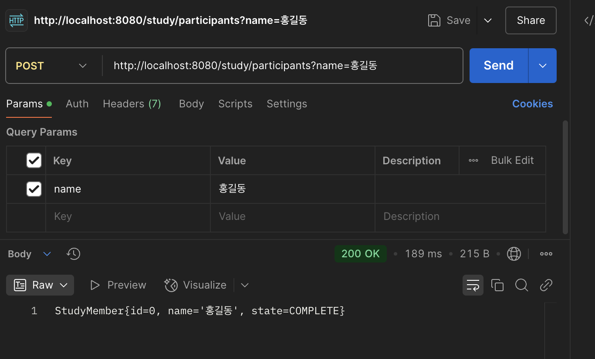
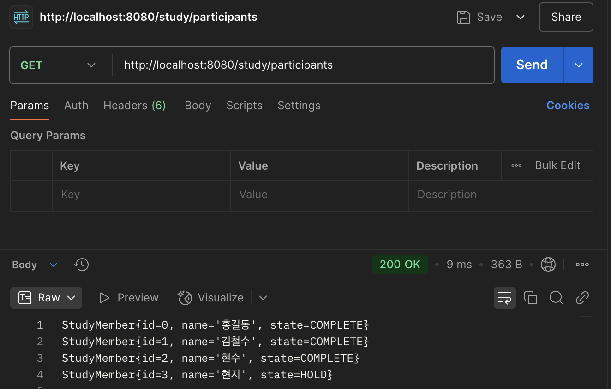
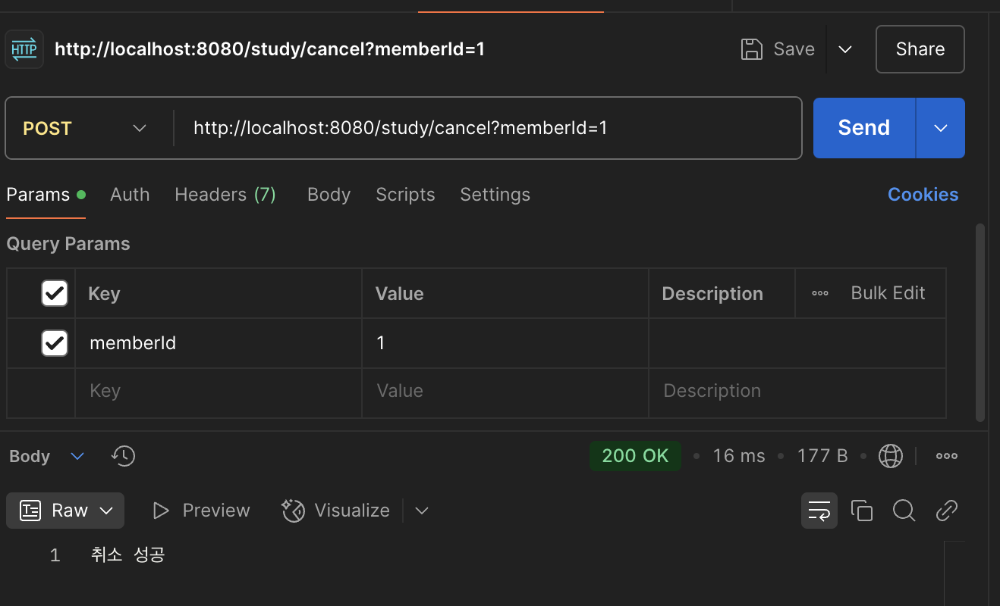
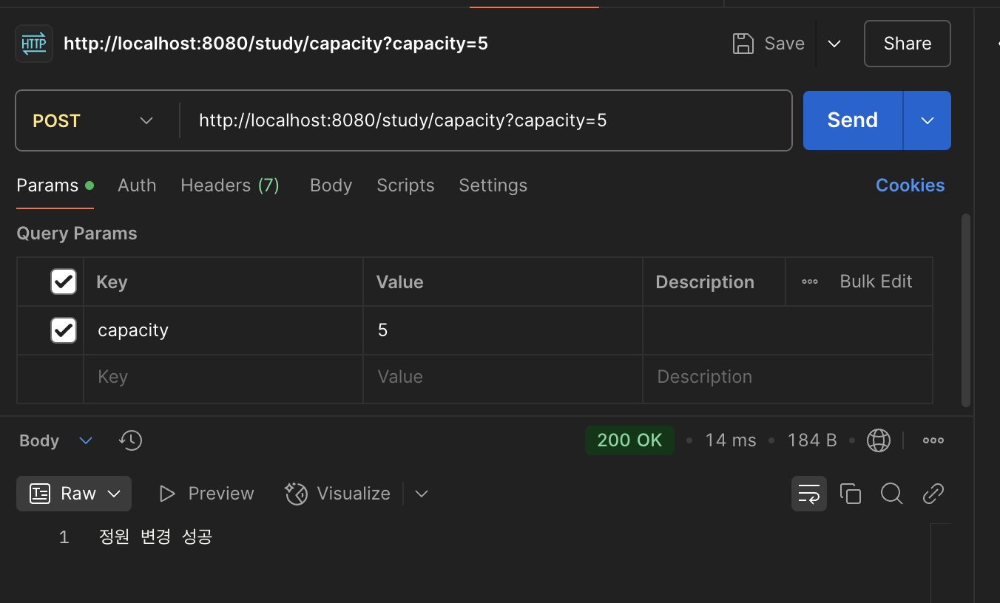

## study-api
스터디 참가 신청을 관리하는 Spring Boot 서버입니다. 
데이터는 메모리에 저장되므로 서버를 재시작하면 초기화됩니다.

## 목표
- [x] 참가 신청 API
- [x] 참가자 명단 조회 API
- [x] 신청 취소 및 대기자 승격 API
- [x] 정원 변경 API

## API
| 기능                      | 요청 | 파라미터         |
|---------------------------|---|------------------|
| 참가 신청                 | `POST /study/participants` | `name`           |
| 참가자 명단 조회          | `GET /study/participants` | x                |
| 신청 취소  및 대기자 승격 | `POST /study/cancel` | `memberId`       |
| 정원 변경                 | `POST /study/capacity` | `capacity`(1~10) |

## 코드 소개
**StudyController**: 스터디 참가자 관리와 정원 변경 요청을 처리하는 Controller입니다.
- `@RestController`: API 요청을 처리하고, 메서드의 반환값을 HTTP 응답 본문에 그대로 전달합니다.
- `@PostMapping`, `@GetMapping`: HTTP 요청 방식과 URL에 따라 각 기능을 연결합니다.
- `@RequestParam`: 요청으로 전달받은 파라미터(`name`, `memberId`, `capacity`)를 메서드의 인자로 받습니다.
- **생성자 주입**: `StudyService`를 생성자로 주입받아 실제 비즈니스 로직 처리를 위임합니다.
- **`Optional` 처리**: 참가자 등록 시 `Optional.map()`과 `orElse()`를 사용하여 등록 성공 시 참가자 정보를, 실패 시 오류 메시지를 반환합니다.

**StudyService**: 스터디 참가 신청, 조회, 취소 및 정원 변경에 대한 비즈니스 로직을 처리하는 Service입니다.

- `@Service`: Spring Bean으로 등록하여 Controller에서 주입받아 사용할 수 있도록 합니다.
- `LinkedHashMap<Long, StudyMember>`: 참가자 정보를 ID를 기준으로 저장하며, 등록된 순서를 유지합니다.
- `capacity`, `capacityCnt`: 스터디 최대 정원과 현재 확정 인원을 관리합니다.
- `signMember()`: 이름의 공백 및 중복 여부를 검사하고, 정원에 따라 참가자를 `COMPLETE`(확정) 또는 `HOLD`(대기) 상태로 등록합니다.
- `findAll()`: 등록된 참가자 정보를 등록 순서대로 조회하고, 참가자가 없으면 안내 메시지를 반환합니다.
- `cancel()`: 참가자 ID의 유효성을 검사하고, 확정 참가자가 취소하면 대기자 중 가장 먼저 신청한 사람을 확정 상태로 변경합니다.
- `changeCapacity()`: 정원을 1~10명 범위에서 변경하며, 확정 인원보다 적게 설정하는 것을 방지하고 정원 증가 시 대기자를 순서대로 확정합니다.
- `isContains()`: 동일한 이름의 참가자가 이미 등록되어 있는지 확인합니다.
- `holdToCompleted()`: 대기자 중 가장 먼저 등록된 참가자를 찾아 확정 상태로 변경합니다.
- `Optional<StudyMember>`: 참가 신청 성공 시 참가자 정보를 반환하고, 공백 또는 중복 이름인 경우 `Optional.empty()`를 반환합니다.

요청 흐름: URL → StudyController → StudyService → 결과 문자열 응답

## 출력 형식

| 상황 | 응답 |
|---|---|
| 신청 성공 | `StudyMember.toString()` 반환 (ID, 이름, 상태) |
| 신청 실패 (공백 또는 중복 이름) | `공백 또는 중복 이름입니다` |
| 참가자 조회 | 참가자마다 한 줄씩 `StudyMember.toString()` 출력 |
| 참가자가 없는 경우 | `참가자가 없습니다` |
| 대기자 취소 성공 | `취소 성공` |
| 확정자 취소 성공 | `취소 성공` (대기자가 있으면 자동 승격) |
| 취소 실패 (잘못된 ID 형식) | `잘못된 형식입니다` |
| 취소 실패 (존재하지 않는 ID) | `없는 id입니다` |
| 정원 변경 성공 | `정원 변경 성공` |
| 정원 변경 실패 (잘못된 형식) | `잘못된 형식입니다` |
| 정원 변경 실패 (1~10 범위 초과) | `1~10만 가능합니다` |
| 정원 변경 실패 (확정 인원보다 작은 정원) | `실패` + `현재 정원: {capacity}` + `현재 확정 인원: {capacityCnt}` (줄바꿈하여 출력) |

## 확인 결과

### 1. 참가 신청 `POST /study/participants`
- 요청 URL: http://localhost:8080/study/participants?name=홍길동
- 상태: 200

### 2. 참가자 명단 조회 `GET /study/participants`
- 요청 URL: http://localhost:8080/study/participants
- 상태: 200

### 3. 신청 취소  및 대기자 승격 `POST /study/cancel`
- 요청 URL: http://localhost:8080/study/cancel?memberId=1
- 상태: 200

### 4. 정원 변경 `POST /study/capacity`
- 요청 URL: http://localhost:8080/study/capacity?capacity=5
- 상태: 200

## QA 체크리스트

### 1. 참가 신청 (`POST /study/participants`)

| 사전 조건                | 입력 | 기대 결과  | 통과 여부 |
|--------------------------|---|-----------------------------|-----------|
| 등록된 참가자 없음       | `name=홍길동` | 확정 상태로 등록 성공       | ✅          |
| 확정 인원 3명 (정원 3명) | `name=김철수` | 대기 상태로 등록 성공       |  ✅         |
| 홍길동이 이미 등록됨     | `name=홍길동` | `공백 또는 중복 이름입니다` |  ✅         |
| 없음                     | `name=` | `공백 또는 중복 이름입니다` |       ✅    |
| 등록된 참가자 없음       | `name= 홍길동 ` | 앞뒤 공백 제거 후 등록 성공 |   ✅        |

### 2. 참가자 조회 (`GET /study/participants`)

| 사전 조건          | 입력 | 기대 결과  | 통과 여부 |
|--------------------|---|---|-----------|
| 등록된 참가자 없음 | 요청 | `참가자가 없습니다` | ✅        |
| 등록된 참가자 있음 | 요청 | 각 참가자의 상태가 올바르게 출력 |  ✅       |

### 3. 참가 취소 (`POST /study/cancel`)

| 사전 조건                | 입력 | 기대 결과                                  | 통과 여부 |
|--------------------------|---|--------------------------------------------|-----------|
| 확정자 존재, 대기자 없음 | `memberId={확정자 ID}` | `취소 성공`, 확정 인원 1명 감소            | ✅        |
| 확정자 및 대기자 존재    | `memberId={확정자 ID}` | `취소 성공`, 첫 번째 대기자 자동 승격      | ✅ |
| 존재하지 않는 ID         | `memberId=999` | `없는 id입니다`                            | ✅ |
| 없음                     | `memberId=abc` | `잘못된 형식입니다`                        | ✅ |
| 없음                     | `memberId=` | `잘못된 형식입니다`                        | ✅ |
| 이미 취소된 참가자       | `memberId={취소된 ID}` | `없는 id입니다`                            | ✅ |

### 4. 정원 변경 (`POST /study/capacity`)

| 사전 조건 | 입력 | 기대 결과  | 통과 여부 |
|---|---|---|-----------|
| 정원 3명, 확정 인원 3명 | `capacity=5` | `정원 변경 성공` | ✅        |
| 정원 3명, 확정 인원 3명 | `capacity=2` | `실패`, 현재 정원 및 확정 인원 출력 | ✅        |
| 정원 3명, 확정 인원 2명 | `capacity=2` | `정원 변경 성공` | ✅        |
| 정원 3명, 대기자 3명 존재 | `capacity=4` | `정원 변경 성공`, 첫 번째 대기자만 승격 | ✅        |
| 없음 | `capacity=1` | `정원 변경 성공` (최솟값) | ✅        |
| 없음 | `capacity=10` | `정원 변경 성공` (최댓값) | ✅        |
| 없음 | `capacity=0` | `1~10만 가능합니다` | ✅        |
| 없음 | `capacity=11` | `1~10만 가능합니다` | ✅        |
| 없음 | `capacity=abc` | `잘못된 형식입니다` | ✅        |
| 없음 | `capacity=` | `잘못된 형식입니다` |  ✅       |
